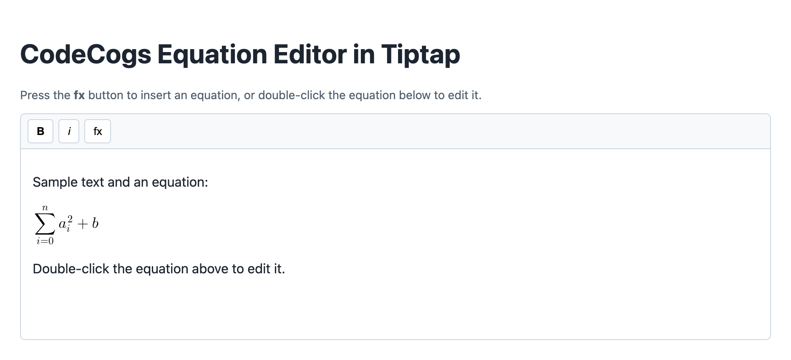
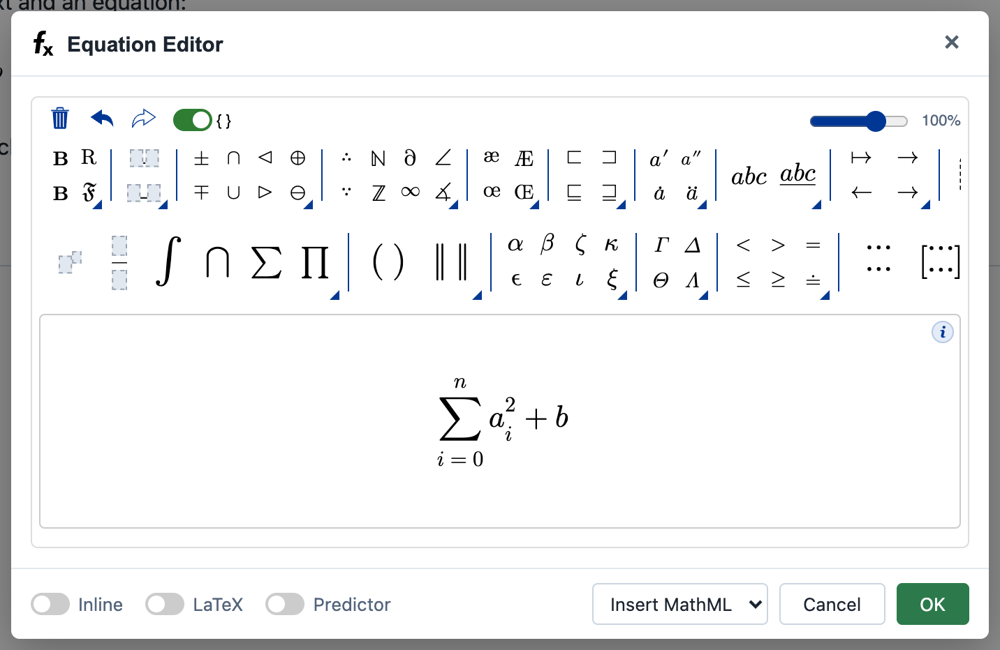

# fxEditor for Tiptap

The fxEditor extension for [Tiptap](https://tiptap.dev) 2, the editor framework built on
ProseMirror. It adds an equation command to your editor that opens fxEditor, CodeCogs' equation
editor - a toolbar of symbols and structures, a LaTeX view and a rendered maths view - in a
dialog, and inserts the finished equation at the selection as MathML or as an SVG image.
Double-click an inserted equation to open it in the editor again.

Tiptap is headless: it has no toolbar of its own. So the extension does not add a button - it
provides a command, `insertEquation()`, which you call from whatever button your interface
already has (the example in this repository uses an **fx** button).

This package is plain ES modules, for your own bundler (Vite, webpack, ...) or a browser import
map. It is published on npm as `@codecogs/fxeditor-tiptap` (MIT).

## Screenshots



*The example editor: the host's own toolbar with an **fx** button, and an inserted equation.*



*The fxEditor dialog that `insertEquation()` opens.*

## Links

- Documentation and live demo: https://fxplugins.codecogs.com/docs/tiptap.html
- Customise and download: https://fxplugins.codecogs.com/docs/tiptap.html#customise
- All fxEditor plugins: https://fxplugins.codecogs.com
- fxEditor: https://fxeditor.codecogs.com

## Installing from git

```bash
git clone https://github.com/willzyba/tiptap.git
```

The extension needs no build step. Add it to your project from the clone, as a local package:

```bash
npm install ./path/to/tiptap
```

It has one peer dependency, `@tiptap/core` 2 or later (it is tested with 2.11.5). Then import
and register it exactly as in [Installing from npm](#installing-from-npm) below.

To try it without a project of your own, the clone has an example page, `example.html`. Replace
its two placeholders first - `{{EQN_SERVER}}` with `https://fxtex.codecogs.com` and `{{FXTEXPRO_KEY}}`
with your licence key - then:

```bash
cd tiptap
npm install
npm start          # serves the folder and opens example.html
```

The example loads Tiptap from a CDN through an import map, so it must be served over http(s),
not opened as a file.

## Installing from npm

The package is being published to npm. Until it appears there, install it from git as above.

```bash
npm install @codecogs/fxeditor-tiptap
```

Import the extension and its stylesheet, register it with your editor, and call
`insertEquation()` from your own toolbar button:

```js
import { Editor } from '@tiptap/core';
import StarterKit from '@tiptap/starter-kit';
import { EqnEditor } from '@codecogs/fxeditor-tiptap';
import '@codecogs/fxeditor-tiptap/eqneditor.css';

const editor = new Editor({
    element: document.querySelector('#editor'),
    extensions: [
        StarterKit,
        EqnEditor.configure({
            server: 'https://fxtex.codecogs.com',
            licence: 'fx_pk_your-key-here',     // from fxeditor.codecogs.com/purchase
            design: { colour: '#0f7a4d' }       // optional - see Customise and download
        })
    ]
});

myToolbarButton.addEventListener('click', () => {
    editor.commands.insertEquation();
});
```

`insertEquation()` opens the dialog and returns straight away; the equation is inserted later,
when the author presses OK. It always returns `true` - whether anything is inserted depends on
what the author does next, not on whether the command could run.

## Licence key

Equations are rendered by fxTeX Pro, which needs a licence key for your domain.

Get your licence key from https://fxeditor.codecogs.com/purchase.

The key goes in the extension's `licence` option:

```js
EqnEditor.configure({ licence: 'fx_pk_your-key-here' })
```

Without one, the editor opens but equations show why they cannot render.

### Options

Passed to `EqnEditor.configure({ ... })`:

| Option | Default | Meaning |
|---|---|---|
| `licence` | `''` | Your fxEditor licence key. Required. |
| `design` | `{}` | The editor's look: dialog width, height and scale, toolbar panels and size, colour, equation and markup sizes, undo/redo, how the dialog opens, and `insertAs` (`'mathml'` or `'svg'`), the dialog's starting *Insert* choice. Build one in [Customise and download](https://fxplugins.codecogs.com/docs/tiptap.html#customise). |
| `server` | `'https://fxtex.codecogs.com'` | Where the equation editor is loaded from, as a URL - or your own fxTeX Server (a bare host is taken as https). |
| `renderUrl` | `'https://fxtex.codecogs.com'` | The service that draws equations inserted as images. |
| `scriptUrl` | from `server` | Full URL of the equation editor bundle, when the default path does not suit. |
| `cssUrl` | from `server` | Full URL of the equation editor stylesheet. |
| `mathmlCssUrl` | from `server` | The MathML stylesheet loaded into the editing area. |
| `HTMLAttributes` | `{}` | Extra attributes for an inserted ``, as for any Tiptap node (MathML has no `src`/`alt` to attach them to). |

## What gets inserted

The author chooses in the dialog: MathML (the default) or an SVG image. Either is stored as a
Tiptap node that carries its LaTeX, so it survives `getHTML()` and `setContent()` intact and can
be reopened by double-clicking it. See
[`getHTML()`/`getJSON()`](https://tiptap.dev/docs/editor/api/editor) for reading the `latex`
attribute back out, for example for search or export.

### MathML needs a stylesheet on the page that displays it

Browsers' own MathML does not cover everything the converter produces, so a page that displays
MathML equations needs this line - the same file fxTeX ships:

```html
<link rel="stylesheet" href="https://fxtex.codecogs.com/fxtex.css">
```

The extension loads it into the editing area for you; it cannot add it to the page that finally
displays the content, because that page is yours, not the editor's.

### Tiptap's schema and `<math>`

Nothing needs configuring: the extension's own node type produces the `<math>` markup, and
Tiptap only serialises what a node's own `renderHTML` returns - there is no separate allow-list
to update.

### Why the extension draws its own dialog

Tiptap is headless by design, so the extension opens a small modal of its own rather than
assuming any particular host UI framework. `eqneditor.css` is only that frame; the equation
editor inside it is styled by the stylesheet loaded from `cssUrl`.

## Testing

`npm test` runs the extension against a real Tiptap/ProseMirror instance (via `jsdom`, not a
mock of either) and checks that `renderHTML`/`parseHTML` round-trip correctly for both images and
MathML. It does not exercise the dialog or the double-click editing, since those need the
equation editor's script loaded from the network.

## Licence

Copyright (c) 2026 CodeCogs, Zyba Ltd.

The extension is released under the MIT licence - see
[`LICENSE`](https://github.com/willzyba/tiptap/blob/main/LICENSE). Tiptap is licensed
separately by its own authors. fxEditor and fxTeX Pro need their own licence key, as above.
